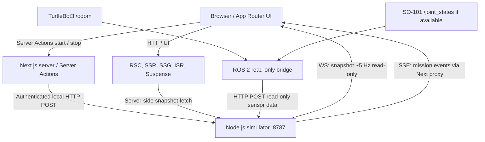

# Physical AI Mission Control

**SO-101 × TurtleBot3 Burger × Next.js × React Three Fiber**

A local-first, simulation-based Physical AI dashboard that demonstrates **App Router, React Server Components (RSC), SSR, SSG, ISR, Server Actions, RSC Streaming, HTTP response streaming, SSE, and WebSocket** in one project. Includes a *read-only* ROS 2 bridge example.

> Safety / scope: **This project does not send any control commands to the real SO-101 or TurtleBot3.** The 3D robot shapes are **approximate conceptual models**, not their URDFs. Motion timing and the pick-and-place sequence are simulated; no IK, physics, collision avoidance, or robot safety system is implemented.

📖 **Documentation (Japanese):** [docs/physical_ai_mission_control_docs.md](docs/physical_ai_mission_control_docs.md)

## Prerequisites

- Node.js 22+, npm 10+.
- A local browser with WebGL support.
- ROS 2 (optional; for telemetry overlay only).

## Start in 3 commands

```bash
npm install
npm run setup
npm run dev:all
```

Open **http://127.0.0.1:3000**. `npm run setup` generates `.env.local` with a random control token. `npm run dev:all` starts:

- Next.js (port **3000**) — RSC/SSR/Server Actions/SSG/ISR/Streaming, dashboard.
- Node simulator (port **8787**, **127.0.0.1 only**) — mission state, read-only WebSocket, SSE, optional ROS 2 telemetry ingress.

Click **Start simulation**. TB3 drives to the docking station, SO-101 performs a conceptual loading sequence, then TB3 carries the cargo to the destination. Observe 3D motion, progress, robot telemetry, and the SSE event log.

**If npm/network access is restricted:** Dependencies must be installed on a network-connected computer. This zip intentionally excludes `node_modules` and does not claim a successful Next.js build in this environment.

## Technologies and their actual demo locations

| Technology | Source file | What to try |
|---|---|---|
| App Router | `app/layout.tsx`, `app/*/page.tsx` | Switch pages in top nav |
| RSC | `app/page.tsx`, `app/ssr/page.tsx` | Server fetches initial simulator state |
| SSR | `app/ssr/page.tsx` | Reload; server render time changes |
| SSG | `app/ssg/page.tsx` | Static robot catalog from build |
| ISR | `app/isr/page.tsx` | `revalidate = 30`; compare timestamps in production mode |
| Server Actions | `app/actions.ts` | Start / Stop simulation |
| RSC Streaming | `app/streaming/page.tsx` | Suspense panels resolve separately |
| HTTP Response Streaming | `app/api/stream/route.ts`, `components/ChunkStreamDemo.tsx` | See each text chunk arrive |
| WebSocket | `scripts/simulator.mjs`, `components/ClientDashboard.tsx` | Live TB3 pose and SO-101 joint telemetry, ~5 Hz |
| SSE | `app/api/events/route.ts`, `components/ClientDashboard.tsx` | Mission events and stage transition log |
| Three.js | `components/RobotScene.tsx` | Orbit/zoom conceptual digital twin |

SSR vs ISR differences are easiest to see with production build:

```bash
npm run build
npm run sim   # another terminal
npm run start # another terminal
```

In development, Next.js caching and prerendering differ from production behavior. ISR checks require refreshes separated by more than 30 seconds and possibly an additional refresh due to stale-while-revalidate semantics.

## Architecture



**SSE and WebSocket are separate protocols.** WebSocket streams high-frequency snapshot data; SSE sends lower-frequency mission-stage events. RSC Streaming streams partially-rendered UI, not telemetry.

## Optional: ROS 2 read-only overlay

This bridge only **subscribes** to standard ROS topics and **POSTs observed telemetry** to the local simulator. It contains no ROS publisher, service call, or action client.

1. Start the simulator and Next.js as above.
2. On the ROS 2 machine (or same local machine), source ROS 2 and your robot workspace.
3. Export the `SIM_CONTROL_TOKEN` generated in `.env.local` **in the ROS terminal**. Do not put it in the browser.
4. Run:

```bash
python3 ros_bridge/bridge.py
```

The bridge subscribes to `/odom` (`nav_msgs/Odometry`) and `/joint_states` (`sensor_msgs/JointState`). Coordinates map ROS `(x, y, yaw)` to scene `(x, z, yaw)`. ROS joint names / publisher topics vary by SO-101 driver; adjust `JOINT_ALIASES` and subscriptions. Angles are assumed to be in **radians**. Values update the rendered pose only; simulator start/stop buttons are disabled during an active ROS overlay. After 5 seconds without ROS data, demo mode becomes available again.

**Machine placement:** Both Next.js and simulator bind to localhost in this starter, so the ROS bridge should run on the **same computer** as the simulator. If ROS 2 runs on another computer, use ROS 2 networking to bring topics to the app computer (recommended) or establish an authenticated tunnel. Do **not** expose the simulator port 8787 directly to the Internet.

**Important limitations:** SO-101 might not publish standard `/joint_states`; its driver may require a custom adapter. `/odom` for TurtleBot3 requires its navigation/odometry system to be running. Physical dimensions, mounting and gripper poses in the scene are illustrative. No real motion command pipeline is offered.

## Security approach

- The simulator listens **only on 127.0.0.1**; no public host binding.
- Server Actions forward start/stop to an authenticated, local-only endpoint. `.env.local` holds a random token and is ignored by Git.
- Browser WebSocket connections are **read-only**. Incoming messages trigger connection closure; a browser cannot send robot commands via WS.
- Browser WS Origin allowlist includes `127.0.0.1:3000` and `localhost:3000`. When customizing the port/origin, adjust `scripts/simulator.mjs` accordingly.
- ROS bridge only subscribes to ROS topics and forwards telemetry to an authenticated local endpoint. This does not replace industrial robot safety requirements.

## Extend to Agentic Robotics

A future research version could add a decision engine (LangGraph or other agent), vision/tactile world model (JEPA), failure detection, and a validated planner, **first in simulator only**. A real robot control service should be a separate component with manual approval, collision checks, hardware E-stop, rate limits and permission boundaries; do not extend this read-only ROS 2 adapter into a control bridge without a safety design.

See `design.md` for suggested interfaces and tests.

## Tests

```bash
npm test        # Node built-in simulation unit tests
npm run typecheck
npm run build
```

`npm test` has no third-party dependencies. Next.js typecheck and build require `npm install`.
