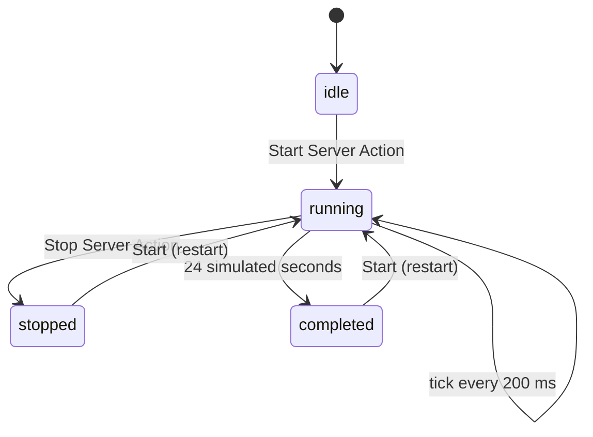

# Design Notes: Physical AI Mission Control

## Goal
Create a coherent architecture testbed where the same robotics workflow uses all required Next.js rendering and network primitives without confusing their responsibilities.

### Render/transport matrix

| Layer | Mechanism | Responsibility | Data freshness |
|---|---|---|---|
| Route | App Router | UI composition and navigation | n/a |
| Server UI | React Server Components | Fetch initial simulator snapshot without client-side API secret | Request scoped |
| Dynamic HTML | SSR (`force-dynamic`) | Request-time rendering | Each request |
| Static HTML | SSG (`force-static`) | Reference robot information | Build time |
| Regenerated HTML | ISR (`revalidate=30`) | Cached lab notes/report | 30-second revalidation |
| Mutation | Server Actions | Start/stop **simulated** mission only | On demand |
| Incremental HTML | RSC Streaming + Suspense | Reveal slow UI sections independently | During request |
| Chunked body | ReadableStream | Deliver textual planner trace | During request |
| Low latency telemetry | WebSocket | Push current pose and arm angles (~5 Hz) | Subsecond |
| Event feed | SSE + EventSource | Phase transitions, mission logs | On event |
| Rendering | Three.js/R3F | View approximate geometry and poses | Visual frame loop |

## Separation of services

The Next.js server exposes UI, SSR, Server Actions and streaming APIs. A separate local Node process owns simulation state and all WebSocket connections; this avoids incorrectly assuming Next.js route handlers natively host persistent WebSocket servers in every deployment environment. The simulator can be replaced by a dedicated ROS 2 middleware adaptor later.

## Demo mission state machine

**Timeline**: 0–35% TB3 approaches dock; 35–68% SO-101 executes a conceptual loading animation; 68–100% TB3 travels to destination. All poses are interpolated, not computed with IK or physics. No Gazebo, Isaac Sim, or MoveIt dependencies are required to run the basic demo.

## ROS 2 interface

**Subscribed topics**: `/odom` (`nav_msgs/msg/Odometry`) and `/joint_states` (`sensor_msgs/msg/JointState`). Bridge maps and posts values as a read-only overlay. External ROS frame alignment, odometry origin and SO-101 joint name mappings need per-robot configuration. A real digital twin should load verified URDFs and apply joint limits, transforms (tf2) and timestamp alignment.

**Non-goals**: Motion planning, real-world control, navigation, collision detection, VLA training, robotic arm actuation, ROS services, remote Internet access. A mission simulated in the web app cannot issue a real ROS 2 command.

## Validation checklist

- `npm test` validates simulation transitions, stop/restart, ROS overlay suppression of local commands.
- `npm run typecheck` checks TS after dependencies installed.
- Build production then check `/ssg`, `/ssr` and `/isr` timestamps separately.
- In browser DevTools, check `/api/events` `Content-Type: text/event-stream` and WS `ws://127.0.0.1:8787/ws` binary/text frame frequency.
- In `/streaming`, observe independent Suspense fallbacks and growing `fetch` response body.
- Ensure start/stop do not create a ROS publisher or actual motor instruction.

## Future research extensions (not implemented)

1. Robot state schema: `timestamp`, `frame_id`, joint positions/velocities, camera calibration, failure codes.
2. ROS2 → backend observation gateway with authentication and read-only ingestion.
3. Vision + tactile feature encoder, JEPA latent world model and state prediction.
4. Long-horizon Agentic workflow: plan, simulate, execute only through a separately safety-reviewed robot controller, evaluate, recover.
5. Replace proxy meshes with robot-specific URDF/GLTF where licensing permits and include calibrated frames.
6. WebXR viewer could be added later via Three.js WebXR/XR modules; not part of this tested starter.
