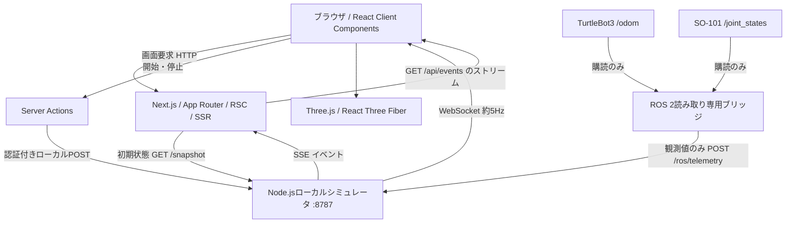
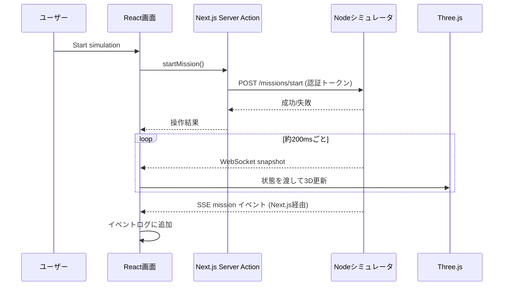
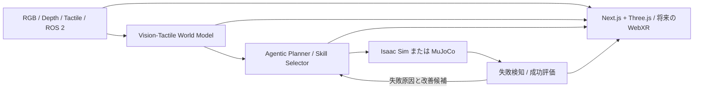

# Physical AI Mission Control — 技術・アーキテクチャ解説

**SO-101 × TurtleBot3 Burger × Next.js × Three.js**  
作成日：2026年11月20日  
対象：React/Next.jsのレンダリング・通信技術を、フィジカルAIの監視アプリケーションとして学習・検証するためのサンプル

> **実装範囲を先に明確にする**  
> このプロジェクトは**ローカル実行の模擬協調搬送アプリケーション**である。3Dロボットは概念モデルで、実機のURDF・逆運動学・衝突判定・自律走行・物理シミュレーションは実装していない。ROS 2との接続例は**テレメトリの読み取り専用**であり、SO-101やTurtleBot3へ制御指令は送信しない。**WebXRは未実装**で、Three.jsによる通常の3Dブラウザ表示を実装している。

## 1. このアプリケーションの目的

Web技術の学習では、SSR・RSC・SSE・WebSocketなどが混同されやすい。しかし、それぞれは異なる問題を解決する。本アプリケーションは、**「TurtleBot3 Burgerが荷物を運び、SO-101が荷物を積み込む」**という一つの仮想タスクを使い、それぞれの技術を使い分ける実験環境である。

学習のポイントは次の4点。

1. **画面をどこで生成するか**：RSC、SSR、SSG、ISR。
2. **ユーザー操作をどう処理するか**：Server Actions。
3. **結果を段階的に届けるにはどうするか**：RSC Streaming、HTTP Response Streaming。
4. **ロボットの状態をどうリアルタイムに反映するか**：WebSocket、SSE、Three.js。

この分離は、将来のVision-Tactile World ModelやAgentic Roboticsにおいても、**計画・推論・UI・実機制御を独立して設計する**うえで重要になる。

## 2. デモのシナリオ

初期状態では、SO-101を固定式マニピュレータ、TurtleBot3 Burgerを移動プラットフォームとして3D空間に表示する。「Start simulation」を押すと、約24秒の**模擬**協調搬送シーケンスが始まる。

| 進捗率 | 模擬ステージ | 画面で確認できること |
|---|---|---|
| 0〜35% | TurtleBot3がドッキング地点へ移動 | 移動体の位置・向きと進捗率の変化 |
| 35〜68% | SO-101が積み込み動作 | アーム関節角・グリッパの概念アニメーション |
| 68〜100% | TurtleBot3が目的地へ移動 | 搬送ステージと完了通知 |

状態は `idle`、`running`、`stopped`、`completed` で管理する。移動と関節動作は補間された仮想値であり、実機の動作計画ではない。

## 3. 全体アーキテクチャ



### Next.jsとシミュレータを分ける理由

Next.jsはUI生成・サーバー描画・フォーム/アクション・HTTP応答を担当する。一方、Node.jsシミュレータは、状態遷移、一定周期の状態更新、WebSocket接続、SSEイベントログを担当する。

この構成なら、WebSocketをNext.jsのRoute Handler内で常駐させられることを前提にせず、ローカルの専用サービスに分離できる。また、将来バックエンドをROS 2対応のプロセスへ置き換える際にも、画面部分への影響を小さくできる。

## 4. React / Next.jsの各技術をどう使っているか

| 技術 | 本来の役割 | アプリ内での用途 | 主なコード |
|---|---|---|---|
| **App Router** | ファイルベースのルーティングとレイアウト | ダッシュボード・比較ページの構成 | `app/layout.tsx`、`app/*/page.tsx` |
| **RSC** | サーバーでコンポーネントを実行し、必要な結果をクライアントへ渡す | 初回ロード時にロボット状態を取得 | `app/page.tsx` |
| **SSR** | 各要求時にサーバーで画面を生成 | 状態・描画時刻の確認 | `app/ssr/page.tsx` |
| **SSG** | ビルド時に静的ページ生成 | SO-101/TB3の静的カタログ | `app/ssg/page.tsx` |
| **ISR** | 静的ページを再検証・再生成 | 30秒設定の実験用ページ | `app/isr/page.tsx` |
| **Server Actions** | クライアントからサーバー関数を呼び出す | 模擬ミッション開始・停止 | `app/actions.ts` |
| **RSC Streaming** | Suspense境界単位でUIを段階表示 | センサー報告・行動計画の遅延表示 | `app/streaming/page.tsx` |
| **HTTP Response Streaming** | HTTP本文をチャンクで逐次返す | 模擬プランナーのテキスト出力 | `app/api/stream/route.ts` |
| **WebSocket** | 継続的な双方向接続を確立 | 約200msごとにロボット状態を配信（この実装は受信専用） | `scripts/simulator.mjs` |
| **SSE** | HTTPを使いサーバーから一方向にイベント配信 | ミッション段階・コマンドイベント | `app/api/events/route.ts` |
| **Three.js / R3F** | WebGLを利用した3D可視化 | TB3の位置・SO-101関節姿勢の描画 | `components/RobotScene.tsx` |

### RSCとSSRの関係

**RSCはコンポーネントの実行モデル、SSRは初期表示のHTMLをサーバーで生成する手法**で、同じ概念ではない。トップページではServer Componentがシミュレータから初期スナップショットを取得し、Client Componentへ渡す。その後の頻繁な更新は、再描画要求を繰り返すのではなくWebSocketが担う。

### SSGとISRがロボティクスで役立つ場面

静的な仕様・ロボットカタログ・研究ノートはSSGに向いている。数十秒〜数分単位で十分な実験集計・稼働レポートはISRが適する。一方、障害検知やロボットの姿勢をISRだけで表示するのは不適切で、WebSocketなどの最新データ経路を利用する。

### Streamingは3種類を区別する

- **RSC Streaming**：画面の部分的な完成を待たずに描画する。`Suspense`が入口。
- **HTTP Response Streaming**：`ReadableStream`のチャンクを順次受け取る。模擬推論ログの逐次表示に適する。
- **SSE**：`text/event-stream`で構造化イベントを送り続ける。通常のブラウザ`EventSource`は自動再接続を扱える。

**SSEはHTTPストリーミングの一形式**だが、RSC Streamingとは目的もデータ形式も異なる。

## 5. 操作から3D画面までのデータフロー



**WebSocketの配信内容**はTurtleBot3の平面位置・向き、アーム関節値、進捗率、ステージ、データソースなどを含むスナップショットである。**SSEの配信内容**は時刻・イベントID・種類・メッセージ・進捗率などを持つログである。頻繁に変わる状態と、不連続な出来事を分けるのが設計上のポイントとなる。

Server Actionsは実機に対する操作ではなく、**ローカルシミュレーションに対する開始・停止要求**のみを送る。これによりブラウザにシミュレータの制御トークンを直接置かずに済む。

## 6. 起動方法

### 前提

- Node.js 22以降 / npm 10以降
- WebGLを利用できるデスクトップブラウザ
- ROS 2はオプション。模擬デモの起動には不要

ZIPを展開したディレクトリで実行する。

```bash
npm install
npm run setup
npm run dev:all
```

`npm run setup`は`.env.local`にローカル用のランダムな制御トークンを生成する。`npm run dev:all`はNext.jsとNode.jsシミュレータを立ち上げる。

| URL | 用途 |
|---|---|
| `http://127.0.0.1:3000/` | メインダッシュボード / 3D監視 |
| `http://127.0.0.1:3000/ssr` | SSR検証 |
| `http://127.0.0.1:3000/ssg` | SSG検証 |
| `http://127.0.0.1:3000/isr` | ISR検証 |
| `http://127.0.0.1:3000/streaming` | RSC/HTTP Streaming検証 |
| `http://127.0.0.1:3000/technology` | 機能とソースコードの対応表 |

ローカルシミュレータは`127.0.0.1:8787`で動作する。これはブラウザUIと別のプロセスであり、外部ネットワークへ公開する想定ではない。

## 7. 動作検証の進め方

1. **メイン画面**：ドラッグで3Dシーンを回転し、スクロールでズームする。Startを押し、TB3移動→SO-101積み込み→TB3搬送が進むか確認する。
2. **WebSocket**：ロボット位置・関節角・進捗表示が周期的に更新されることを確認する。開発者ツールのNetwork → WSでも受信フレームを確認できる。
3. **SSE**：Start・Stopやステージ変更時にイベントログが増えるか確認する。Networkで`/api/events`のContent-Typeが`text/event-stream`になっているか調べる。
4. **SSR**：`/ssr`をリロードし、サーバー描画時刻が変わるか確認する。
5. **SSG / ISR**：開発モードと本番モードでキャッシュ挙動が異なるため、以下のように本番ビルドで確認する。
6. **Streaming**：`/streaming`で、Suspenseによる画面の段階表示と、テキストチャンクの逐次出力を別々に観察する。

```bash
npm run build
# ターミナル1
npm run sim
# ターミナル2
npm run start
```

`/ssg`の生成時刻は基本的に再ビルドまで変わらない。`/isr`は`revalidate = 30`を指定しており、30秒経過後のアクセスで再検証が始まるため、**そのアクセス直後に必ず時刻が変わるとは限らない**。必要に応じて次のリロードで確認する。

### テストコマンド

```bash
npm test
npm run typecheck
npm run build
```

**検証状況の注意**：既存プロジェクトではNode.jsのシミュレーション・構成テスト8件が通過している。ただし、この作成環境では依存パッケージの取得ができず、Next.jsの型チェック・本番ビルド・ブラウザ表示を最後まで検証できていない。ローカル実行時はその点を確認する必要がある。

## 8. ROS 2実機テレメトリを表示する場合

提供した`ros_bridge/bridge.py`は、以下のトピックを**購読**する。

| ROS 2トピック | 型 | 利用する情報 |
|---|---|---|
| `/odom` | `nav_msgs/msg/Odometry` | TB3の位置 `(x, y)` とyaw |
| `/joint_states` | `sensor_msgs/msg/JointState` | SO-101の関節角（名前のマッピングが必要） |

ROS座標系の平面`(x, y)`を描画側の`(x, z)`に対応させている。関節角度はラジアンとして扱う。ブリッジは収集した値を認証付きHTTP POSTでシミュレータに渡し、画面側はWebSocketから受信した値を表示する。

```bash
# ROS 2環境とワークスペースを読み込んでから実行
# .env.localのSIM_CONTROL_TOKENをこのシェルに環境変数として設定する
python3 ros_bridge/bridge.py
```

**この段階の制限**：SO-101のドライバは、標準`/joint_states`を発行しない場合がある。実機のトピック名・関節名を確認し、`JOINT_ALIASES`を合わせる必要がある。TurtleBot3では`/odom`を配信するノードが起動している必要がある。ブリッジはデフォルトで同一PC上のシミュレータへ接続するため、ROS 2とアプリが別PCの場合は、同一ホストへトピックを転送する構成などが別途必要になる。

ROS 2由来のデータが有効な間、画面のStart/Stop操作は無効化される。約5秒間データが届かなくなると、デモモードを再び利用できる設計である。これは制御の安全を保証する機能ではなく、**読み取り用途と模擬操作を混同しないためのUI上の分離**である。

## 9. 現在できること / まだできないこと

| 区分 | 機能 | 状態 |
|---|---|---|
| 画面 | Next.js App Router、RSC、SSR、SSG、ISR | 実装済み（本番ビルド未検証） |
| 操作 | Server Actionsから模擬ミッション開始・停止 | 実装済み |
| 通信 | WebSocket、SSE、HTTP Streaming | 実装済み |
| 3D | Three.jsで概念ロボットを可視化 | 実装済み |
| ROS 2 | `/odom`、`/joint_states`の購読と表示 | サンプル実装済み（個別ドライバとの実機検証は未実施） |
| 実機制御 | TB3の`/cmd_vel`、SO-101のサーボ制御 | **未実装** |
| ロボットモデル | 正確なURDF、TF、IK、衝突判定 | **未実装** |
| シミュレーション | Isaac Sim、Gazebo、MuJoCo接続 | **未実装** |
| AI | VLA、JEPA、失敗検知、自己改善エージェント | **未実装** |
| XR | WebXR / Quest 3対応 | **未実装** |

## 10. フィジカルAI研究への発展案

本デモを、**「観測 → 状態推定 → 予測 → 計画 → 実行 → 評価」**を可視化する研究基盤へ拡張できる。



この図は**今後の構想**であり、現行ソースに組み込まれている機能ではない。研究拡張はまずシミュレーションで行い、実機の制御サービスは独立させる。実機へ接続する際は、権限管理・操作承認・衝突回避・関節制限・ウォッチドッグ・非常停止などの安全機構を別途設計する。

WebXRを加える場合は、まず**Three.jsの既存シーンをQuest 3で観察するビューア**から始めるのが現実的である。ロボット操作へ拡張する前に、表示遅延、座標系、スケール、操作権限を検証する。

## 11. 参考となるソースコードの読み順

1. `app/page.tsx`：初期データ取得とRSC/Client Componentの接続。
2. `components/ClientDashboard.tsx`：WebSocket・EventSource・Server Actionsの統合。
3. `components/RobotScene.tsx`：3D可視化。
4. `app/actions.ts`と`lib/simulator-api.ts`：サーバー側からの操作処理。
5. `scripts/sim-core.mjs`：ミッション状態遷移と時間経過の計算。
6. `scripts/simulator.mjs`：WebSocket・SSE・HTTP API。
7. `app/ssr/page.tsx`、`app/ssg/page.tsx`、`app/isr/page.tsx`：レンダリング方式の比較。
8. `app/streaming/page.tsx`、`app/api/stream/route.ts`：二種類のストリーミング。
9. `ros_bridge/bridge.py`：読み取り専用ROS 2連携。

---

## まとめ

**RSC/SSR/SSG/ISRは「画面をどこでいつ生成するか」、Server Actionsは「ユーザー操作をサーバーでどう処理するか」、Streamingは「結果をどう段階配信するか」、WebSocket/SSEは「継続的な変化をどう届けるか」を担当する。** Three.jsはその状態を空間的に可視化するレイヤーである。

このように責務を分割すると、後からROS 2の観測情報、Agentic Robotics、Vision-Tactile World Model、そしてWebXRを追加する場合にも、段階的に検証しやすくなる。
